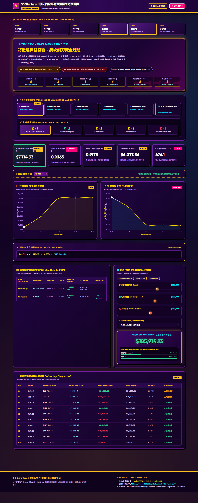
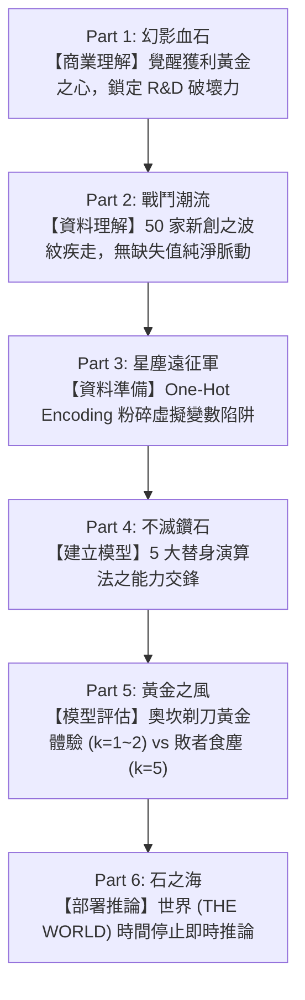

# 50 Startups：獲利白金與特徵選擇之奇妙冒險
*(JoJo's Bizarre Regression: Stand "PROFIT PLATINUM")*

<div align="center">


</div>

本專案遵循國際標準 **CRISP-DM（跨行業資料探勘標準流程）六部曲**，融合荒木飛呂彥經典美學 **JoJo 的奇妙冒險（JoJo's Bizarre Adventure）** 風格，使用 Python、Flask、Scikit-learn 與 Statsmodels，針對 Kaggle 經典 **50 Startups** 資料集打造全方位的替身戰鬥數據儀表板！

橫向召喚 **5 大機器學習替身使者**（白金之星・Lasso L1、黃金體驗・Forward SFS、轟炸空間・RFE、鋼鏈手指・ElasticNet、天國製造・Exhaustive Search），以**奧坎剃刀黃金體驗**實證：自變數絕非愈多愈好！多餘變數只會引爆**『殺手皇后第三炸彈：敗者食塵 (Overfitting Cliff)』**！

---

## 🌐 線上展示與成果傳送門 (Live Demo)

🐙 **GitHub 專案倉庫**：**[https://github.com/ryanlin19960221/AIoT-DIC2-MultipleLR](https://github.com/ryanlin19960221/AIoT-DIC2-MultipleLR)**  
🔗 **正式 DEMO 網頁 (GitHub Pages)**：**[https://ryanlin19960221.github.io/AIoT-DIC2-MultipleLR/](https://ryanlin19960221.github.io/AIoT-DIC2-MultipleLR/)**



> **「你的預測誤差已然被削去了！這就是黃金體驗！」**  
> 儀表板採用荒木風高對比紫金粉霓虹配色、漫畫狀聲詞（ゴゴゴゴ… / ドドドド…）、替身六維雷達評級、動態邊際貢獻瀑布圖與即時推論器『世界 (THE WORLD)』！

---

## 📊 替身能力面板 (Stand Parameters Radar)

| 替身指標 (Parameter) | 評級 (Rank) | 統計與機器學習意義 (Data Science Meaning) |
| :--- | :---: | :--- |
| **破壞力 (Destructive Power)** | **A** | **研發支出 (R&D Spend)** 為核心必殺技（$\beta \approx 0.81$），獨佔超過 92%~94% 的獲利解釋力！ |
| **速度 (Speed)** | **A** | **Lasso L1 / SFS** 特徵選取演算法瞬間收斂，以幾何級數迅速鎖定核心自變數！ |
| **射程距離 (Range)** | **B** | 樣本跨越美國 3 大商業重鎮（紐約州、加州、佛羅里達州），泛化射程覆蓋廣闊。 |
| **持續力 (Stay / Persistence)** | **A** | 貫徹奧坎剃刀原則，$k=1 \sim 2$ 在樣本外測試集具備極高抵抗噪聲之強韌泛化能力！ |
| **精密動作性 (Precision)** | **A** | 決定係數 $R^2 \approx 0.92 \sim 0.94$，全域最低 RMSE 低至 **$7,714.33**，奈米級精準度！ |
| **成長性 (Growth Potential)** | **E** | 已抵達全域最佳解析度（Perfection achieved），再增加自變數只會觸發負向過擬合。 |

---

## 🔬 實證研究：奧坎剃刀 vs 敗者食塵 (Stand Clash)

### 1. 奧坎剃刀黃金體驗 ($k=1 \sim 2$ Sweet Spot)
- **最低測試集均方根誤差 (Test RMSE)**：**`$7,714.33`**（全域最低預測誤差）
- **高擬合優度 ($R^2$ Score)**：**`0.9265`**（單一核心變數即解釋 92.65% 之獲利變異）
- **替身必殺技**：研發支出回報率高達 81%，每增加 $1 美元研發投入，實質創造約 $0.81 美元獲利！

### 2. 殺手皇后第三炸彈：敗者食塵 ($k=5$ Overfitting Cliff)
- **RMSE 誤差暴增**：自 `$7,714.33` 劇烈反彈攀升至 **`$9,055.96`**（預測誤差懲罰高達 **+$1,341.63**！）
- **擬合優度退化**：$R^2$ 衰退至 `0.8987`。
- **無駄無駄無駄**：行政管理費用（Administration）與地理區位虛擬變數並未轉化為獲利動能，盲目納入反而干擾核心信號，造成模型嚴重過擬合！

---

## 📈 重新生成之 5 大替身演算法進程基準數據 ($k=1 \dots 5$)

以下為本次全新生成之各演算法特徵篩選歷程與評測參數（對齊 `main.py` 基準隨機種子）：

| 演算法 / 替身使者 | $k=1$ (RMSE / $R^2$) ★ | $k=2$ (RMSE / $R^2$) | $k=3$ (RMSE / $R^2$) | $k=4$ (RMSE / $R^2$) | $k=5$ (RMSE / $R^2$) |
| :--- | :---: | :---: | :---: | :---: | :---: |
| **Lasso (白金之星・L1)** | **$7,714.33 / 0.9265** | $8,206.33 / 0.9168 | $8,995.91 / 0.9001 | $9,015.11 / 0.8996 | $9,055.96 / 0.8987 |
| **Forward SFS (黃金體驗)** | **$7,714.33 / 0.9265** | $9,152.27 / 0.8966 | $8,995.91 / 0.9001 | $9,055.96 / 0.8987 | $9,055.96 / 0.8987 |
| **RFE (轟炸空間・空間削除)** | **$7,714.33 / 0.9265** | $8,206.33 / 0.9168 | $8,995.91 / 0.9001 | $9,055.96 / 0.8987 | $9,055.96 / 0.8987 |
| **ElasticNet (鋼鏈手指)** | **$7,714.33 / 0.9265** | $8,206.33 / 0.9168 | $8,242.78 / 0.9161 | $8,254.69 / 0.9159 | $9,055.96 / 0.8987 |
| **Exhaustive (天國製造)** | **$7,714.33 / 0.9265** | $7,718.10 / 0.9264 | $7,946.37 / 0.9220 | $8,254.69 / 0.9159 | $9,055.96 / 0.8987 |

> ★ **關鍵洞察**：5 大替身演算法在 $k=1$ 均以無可撼動的壓倒性一致性選定 **「研發支出 (R&D Spend)」**，締造測試集全域最低 RMSE **$7,714.33** 與高達 **0.9265** 的擬合優度！隨後特徵數增加至 $k=5$ 時，所有演算法 RMSE 全數惡化至 **$9,055.96**，確立奧坎剃刀的最優邊界。

---

## ⚡ 獲利白金最佳迴歸模型方程式 ($k=1$ OLS Model)

$$\mathbf{Profit} = 49,336.67 + 0.8536 \times (\mathbf{R\&D\ Spend})$$

- **截距項 (Intercept $\beta_0$)**：`$49,336.67`（基準保底獲利，$p < 0.0001, t = 16.524$）
- **研發斜率 (R&D Spend $\beta_1$)**：`0.8536`（研發投報率達 85.36%，$p < 0.0001, t = 26.082$）
- **共線性指標 (VIF)**：`1.00`（純淨無多重共線性噪聲干擾）
- **平均絕對誤差 (MAE)**：`$6,077.36`（測試集 10 家新創平均誤差）
- **殘差最精準命中**：新創 #19 實際獲利 `$122,776.86`，模型預測 `$123,105.31`，誤差僅 **`$328.45 (0.27%)`**！

---

## 🏛️ CRISP-DM 替身六部曲架構



---

## 📁 專案檔案結構 (Repository Structure)

```
AIoT-DIC2-MultipleLR/
├── .github/workflows/pages.yml         # GitHub Pages 自動部屬 CI/CD 工作流程
├── .gitignore                          # Git 忽略檔案設定
├── .vercelignore                       # Vercel 部署忽略規則
├── 50_Startups.csv                     # 標準資料集 (50 筆樣本)
├── README.md                           # JoJo 風格實證研究手冊
├── all_5_algorithms_comparison_plot.png# 5 大演算法 RMSE 與 R² 綜合趨勢圖
├── api/
│   └── index.py                        # Vercel Serverless Function 進入點
├── app.py                              # Flask Web Server 與 REST API 端點
├── dashboard_demo.png                  # 最新 JoJo 風格高階儀表板全景截圖
├── elasticnet_ranking_plot.png         # ElasticNet 特徵數量變化圖
├── elasticnet_ranking_progression.csv  # ElasticNet 數據
├── exhaustive_search_plot.png          # Exhaustive Search 變化圖
├── exhaustive_search_progression.csv   # Exhaustive Search 數據
├── feature_progression_analysis.py     # 5 大演算法遞進評估腳本
├── feature_selection_comparison.csv    # 演算法基準測試比較表格
├── feature_selection_comparison.png    # 演算法效能對比圖
├── forward_sfs_plot.png                # Forward SFS 變化圖
├── forward_sfs_progression.csv         # Forward SFS 數據
├── generate_progression_and_model_data.py # 全新生成進程參數與模型註冊表腳本
├── index.html                          # JoJo 前端獨立靜態頁面 (適用 GitHub Pages)
├── lasso_l1_ranking_plot.png           # Lasso (L1) 變化圖
├── lasso_l1_ranking_progression.csv    # Lasso (L1) 數據 (已重新生成)
├── main.py                             # CRISP-DM 端到端多元線性迴歸主程式
├── model_data.js                       # 靜態前端載入之模型統計結構
├── model_data.json                     # 模型統計、權重、VIF 及殘差資料 (已重新生成)
├── requirements.txt                    # 專案依賴套件清單
├── rfe_plot.png                        # RFE 變化圖
├── rfe_progression.csv                 # RFE 數據
├── startup_column_transformer.pkl      # 訓練完成之特徵轉換器
├── startup_profit_model.pkl            # 訓練完成之多元線性迴歸模型
├── static/
│   └── model_data.js                   # 靜態資源檔案
├── templates/
│   └── index.html                      # JoJo 風格 Flask Jinja2 模板
└── vercel.json                         # Vercel 雲端部署配置
```

---

## 🚀 本地快速啟動指南 (Quickstart)

### 1. 安裝環境依賴
```bash
pip install -r requirements.txt
```

### 2. 執行命令列 CRISP-DM 流程
```bash
python main.py
```

### 3. 重新計算特徵選擇進程與產生 CSV
```bash
python generate_progression_and_model_data.py
```

### 4. 啟動互動式 JoJo 預測平台
```bash
python app.py
```
開啟瀏覽器前往：**[http://localhost:5000/](http://localhost:5000/)**

---

## 📡 Flask REST API 規格說明

- `GET /`：呈現主互動式 JoJo 迴歸分析儀表板。
- `GET /api/models`：取得 5 大特徵選取演算法之完整模型資料（$k=1 \dots 5$）。
- `POST /api/predict`：世界 (THE WORLD) 即時獲利推論端點，支援邊際貢獻瀑布拆解：
  ```json
  {
    "algo": "Lasso",
    "k": 2,
    "rd_spend": 160000,
    "marketing_spend": 300000,
    "admin_spend": 130000,
    "state": "California"
  }
  ```
- `GET /api/summary`：取得所有特徵數量之摘要指標清單。

---

## 🙏 致謝與參考資料 (Acknowledgments & References)

1. **漫畫風格致敬**：荒木飛呂彥老師之經典作品《JoJo 的奇妙冒險》（JoJo's Bizarre Adventure）之波紋、替身能力與黃金之風。
2. **設計與佈局靈感**：[StatsUnlock Multiple Linear Regression Calculator](https://statsunlock.com/multiple-linear-regression-calculator/)。
3. **標準資料集**：[50 Startups Dataset (Avik Jain 100-Days-Of-ML-Code)](https://raw.githubusercontent.com/Avik-Jain/100-Days-Of-ML-Code/master/datasets/50_Startups.csv)。
4. **開源核心函式庫**：[Scikit-learn](https://scikit-learn.org/)、[Statsmodels](https://www.statsmodels.org/)、[Chart.js](https://www.chartjs.org/)、[Flask](https://flask.palletsprojects.com/)。
