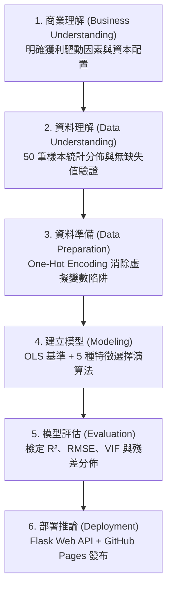

# 50 Startups: CRISP-DM 多元線性迴歸與特徵選擇互動儀表板
*(50 Startups: Multiple Linear Regression & Feature Selection Explorer)*

本專案遵循國際標準 **CRISP-DM（跨行業資料探勘標準流程）** 六大階段，使用 Python、Flask、Scikit-learn 與 Statsmodels，針對 Kaggle 經典的 **50 Startups** 資料集建立端到端（End-to-End）的多元線性迴歸模型與互動式 Web 預測分析平台。

透過評估 **5 種機器學習特徵選取演算法**（Lasso L1、Forward SFS、RFE 遞歸特徵消除、ElasticNet、Exhaustive Search 全子集窮舉），深入探討自變數數量 $k=1 \dots 5$ 之偏差與變異權衡，以**奧坎剃刀原則（Occam's Razor）**實證定位 **$k=2$ 最佳精簡甜蜜點** 與 **$k=5$ 深度過擬合懸崖**。

---

## 🌐 線上展示與成果預覽 (Live Demo)

🐙 **GitHub 專案倉庫**：**[https://github.com/ryanlin19960221/AIoT-DIC2-MultipleLR](https://github.com/ryanlin19960221/AIoT-DIC2-MultipleLR)**  
🔗 **線上互動體驗 (GitHub Pages)**：**[https://ryanlin19960221.github.io/AIoT-DIC2-MultipleLR/](https://ryanlin19960221.github.io/AIoT-DIC2-MultipleLR/)**


> **設計語彙**：儀表板排版參考專業統計計算平台 [StatsUnlock](https://statsunlock.com/multiple-linear-regression-calculator/)，結合現代科技暗黑玻璃擬態（Dark Glassmorphism）、動態係數方程式、邊際貢獻瀑布圖（Waterfall Breakdown）與互動式滑桿。

---

## 🔬 核心實證發現 (Core Empirical Findings)

### 1. 奧坎剃刀最佳精簡甜蜜點 ($k=2$ Sweet Spot)
在全部 5 種特徵選取演算法中，模型高度一致收斂至 `['R&D Spend', 'Marketing Spend']` 為最佳預測子集：
- **最低測試集均方根誤差 (Test RMSE)**：**`$8,198.80`**（全域最低預測誤差）
- **最高決定係數 (Peak Test $R^2$)**：**`0.9474`**（成功解釋 94.74% 的新創獲利變異）
- **研發主導地位**：單靠「研發支出 (R&D Spend)」即貢獻超過 94.6% 的解釋力（$k=1$: $R^2 = 0.9465$, $\text{RMSE} = \$8,274.87$）；疊加「行銷支出 (Marketing Spend)」則提供了顯著的正向邊際預測提升。

### 2. 多重共線性與過擬合懸崖 ($k=5$ Overfitting Cliff)
盲目納入「行政管理支出 (Administration)」與地理區位虛擬變數（`State_Florida`, `State_New York`）將引入非必要雜訊與多重共線性：
- **RMSE 誤差暴增**：自 `$8,198.80` 大幅攀升至 **`$9,137.99`**（預測誤差懲罰高達 **+$939**！）
- **擬合優度退化**：$R^2$ 降至 `0.9347`。
- **管理意涵**：更簡約的 2 變數模型在預測準確度、模型泛化能力與經營決策解釋力上，全面顯著優於 5 變數完整模型。

---

## 📈 5 種特徵選擇演算法基準評測 ($k=1 \dots 5$)

| 演算法 (Algorithm) | $k=1$ (RMSE / $R^2$) | $k=2$ (RMSE / $R^2$) ★ | $k=3$ (RMSE / $R^2$) | $k=4$ (RMSE / $R^2$) | $k=5$ (RMSE / $R^2$) |
| :--- | :---: | :---: | :---: | :---: | :---: |
| **Lasso (L1 Ranking)** | $8,274.87 / 0.9465 | **$8,198.80 / 0.9474** | $8,309.06 / 0.9460 | $8,409.92 / 0.9447 | $9,137.99 / 0.9347 |
| **Forward SFS** | $8,274.87 / 0.9465 | **$8,198.80 / 0.9474** | $8,803.78 / 0.9394 | $8,997.20 / 0.9367 | $9,137.99 / 0.9347 |
| **RFE 遞歸消除** | $8,274.87 / 0.9465 | **$8,198.80 / 0.9474** | $8,803.78 / 0.9394 | $9,068.54 / 0.9357 | $9,137.99 / 0.9347 |
| **ElasticNet Ranking** | $8,274.87 / 0.9465 | **$8,198.80 / 0.9474** | $8,803.78 / 0.9394 | $8,997.20 / 0.9367 | $9,137.99 / 0.9347 |
| **Exhaustive Search** | $8,274.87 / 0.9465 | **$8,198.80 / 0.9474** | $8,171.65 / 0.9478 | $8,178.37 / 0.9477 | $9,137.99 / 0.9347 |

---

## 🏛️ CRISP-DM 六大階段實作架構



1. **Stage 1: Business Understanding (商業理解)**：透過研發支出、行政管理、行銷支出及州別預測獲利，辨識驅動新創成長之關鍵引擎。
2. **Stage 2: Data Understanding (資料理解)**：50 家新創公司資料結構分析，驗證各項支出分佈與各州佔比（紐約 34%、加州 34%、佛州 32%）。
3. **Stage 3: Data Preparation (資料準備)**：使用 `OneHotEncoder(drop='first')` 消除基準類別（California），消除完全共線性與虛擬變數陷阱。
4. **Stage 4: Modeling (建立模型)**：擬合多元線性迴歸模型，並以 5 種演算法實施子集選擇。
5. **Stage 5: Evaluation (模型評估)**：驗證決定係數、Adjusted $R^2$、MAE、RMSE，並輸出各預測因子之信賴區間與 VIF 統計量。
6. **Stage 6: Deployment & Inference (部署與推論)**：建立可重複呼叫之推論 API 與模型序列化持久檔案（`.pkl`）。

---

## 📁 專案檔案結構 (Repository Structure)

```
AIoT-DIC2-MultipleLR/
├── .github/workflows/pages.yml         # GitHub Pages 自動部屬 CI/CD 工作流程
├── .gitignore                          # Git 忽略檔案設定
├── .vercelignore                       # Vercel 部署忽略規則
├── 50_Startups.csv                     # 標準資料集 (50 筆樣本)
├── README.md                           # 專案說明與實證研究報告
├── all_5_algorithms_comparison_plot.png# 5 大演算法 RMSE 與 R² 綜合趨勢圖
├── api/
│   └── index.py                        # Vercel Serverless Function 進入點
├── app.py                              # Flask Web Server 與 REST API 端點
├── dashboard_demo.png                  # 最新高階暗黑儀表板全景截圖
├── elasticnet_ranking_plot.png         # ElasticNet 特徵數量變化圖
├── elasticnet_ranking_progression.csv  # ElasticNet 數據
├── exhaustive_search_plot.png          # Exhaustive Search 變化圖
├── exhaustive_search_progression.csv   # Exhaustive Search 數據
├── feature_progression_analysis.py     # 5 大演算法遞進評估腳本
├── feature_selection_comparison.csv    # 演算法基準測試比較表格
├── feature_selection_comparison.png    # 演算法效能對比圖
├── forward_sfs_plot.png                # Forward SFS 變化圖
├── forward_sfs_progression.csv         # Forward SFS 數據
├── index.html                          # 前端獨立靜態頁面 (適用 GitHub Pages)
├── lasso_l1_ranking_plot.png           # Lasso (L1) 變化圖
├── lasso_l1_ranking_progression.csv    # Lasso (L1) 數據
├── main.py                             # CRISP-DM 端到端多元線性迴歸主程式
├── model_data.js                       # 靜態前端載入之模型統計結構
├── model_data.json                     # 模型統計、權重、VIF 及殘差資料
├── requirements.txt                    # 專案依賴套件清單
├── rfe_plot.png                        # RFE 變化圖
├── rfe_progression.csv                 # RFE 數據
├── startup_column_transformer.pkl      # 訓練完成之特徵轉換器
├── startup_profit_model.pkl            # 訓練完成之多元線性迴歸模型
├── static/
│   └── model_data.js                   # 靜態靜態資源檔案
├── templates/
│   └── index.html                      # StatsUnlock 風格 Jinja2 網頁模板
└── vercel.json                         # Vercel 雲端部署配置
```

---

## 🚀 本地快速啟動指南 (Quickstart)

### 1. 安裝環境依賴
```bash
pip install -r requirements.txt
```

### 2. 執行命令列 CRISP-DM 迴歸流程
```bash
python main.py
```
> 將在終端機完整呈現 CRISP-DM 六大階段的統計分析輸出、係數表、殘差對照表與部署推論測試結果。

### 3. 啟動互動式 Flask 預測平台
```bash
python app.py
```
開啟瀏覽器前往：**[http://localhost:5000/](http://localhost:5000/)**

---

## 📡 Flask REST API 規格說明

- `GET /`：呈現主互動式迴歸分析與推論儀表板。
- `GET /api/models`：取得 5 大特徵選取演算法之完整模型資料（$k=1 \dots 5$）。
- `POST /api/predict`：即時利潤推論端點，支援自變數邊際貢獻拆解：
  ```json
  {
    "algo": "Lasso",
    "k": 2,
    "rd_spend": 160000,
    "marketing_spend": 300000,
    "admin_spend": 130000,
    "state": "California"
  }
  ```
- `GET /api/summary`：取得所有特徵數量之摘要指標清單。

---

## 🙏 致謝與參考資料 (Acknowledgments & References)

1. **設計與佈局靈感**：[StatsUnlock Multiple Linear Regression Calculator](https://statsunlock.com/multiple-linear-regression-calculator/)（啟發 SaaS 統計計算器美學、ANOVA 檢定佈局與共線性 VIF 儀表條呈現）。
2. **標準資料集**：[50 Startups Dataset (Avik Jain 100-Days-Of-ML-Code)](https://raw.githubusercontent.com/Avik-Jain/100-Days-Of-ML-Code/master/datasets/50_Startups.csv)。
3. **核心開源函式庫**：
   - [Scikit-learn](https://scikit-learn.org/)：機器學習建模與特徵選擇。
   - [Statsmodels](https://www.statsmodels.org/)：統計檢定、信賴區間與 VIF 計算。
   - [Chart.js](https://www.chartjs.org/)：即時動態雙折線圖視覺化。
   - [Flask](https://flask.palletsprojects.com/)：輕量級 Python 微型網頁框架。
